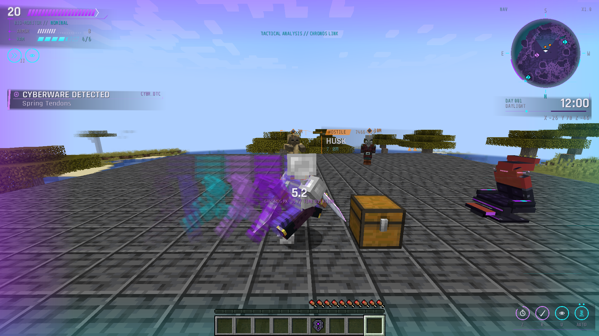

# Chrome Néon

Mod Minecraft cyberpunk : cyberware réparti dans tout le corps, hacking, HUD néon, caméra numérique et VESPER,
l'IA de biopuce. Mod indépendant (aucune dépendance à Arcanes Oubliés ni à un autre mod).

| | |
|---|---|
| Mod ID | `chromeneon` |
| Minecraft | 1.21.1 |
| Loader | NeoForge 21.1.x (développé avec 21.1.262) |
| Java | 21 |
| Build | Gradle 9.2.1 (wrapper) + ModDevGradle 2.0.148 |

## État : phase 3 terminée (cyberware)



- **Phase 1, fondations** : registres, architecture du corps (7 emplacements), règles d'installation, données
  persistantes du joueur, RAM, synchronisation, configurations, commandes. Voir [docs/ARCHITECTURE.md](docs/ARCHITECTURE.md).
- **Phase 2, HUD** : santé en chevrons, armure, cellules de RAM, horloge du monde, indicateurs de statut,
  mini-carte réelle, ciblage et scan de vraies cibles, notifications à priorités, appel entrant, effets de dégâts,
  de santé critique et de glitch, typographie vectorielle (Rajdhani et Share Tech Mono, licence OFL) et 42 icônes vectorielles originales, entièrement configurable.
  Voir [docs/HUD.md](docs/HUD.md) et les [captures réelles](docs/screenshots/).
- **Phase 3, cyberware** : 8 emplacements du corps, humanité et capacité, pannes sous tension, fauteuil de
  charcudoc (modèle 3D, siège, chirurgie validée par le serveur), interfaces Cyberware et Chirurgie, 9 implants
  fonctionnels : Accélérateur Chronos Mk.I/II/III (système d'exploitation de type Sandevistan, vrai ralentissement
  du monde, critiques, images rémanentes), Lames Faucheuse (attaques, fente guidée, rendu 1re/3e personne), Tendons
  Ressort (double saut), Derme Carapace (blindage intégré aux dégâts), Pompe Hémostat (injection d'urgence),
  Optiques Argus (scanner, zoom, analyse tactique), Coprocesseur Synapse (RAM). 22 sons originaux synthétisés.
  Voir [docs/CYBERWARE.md](docs/CYBERWARE.md) et les [captures](docs/screenshots/phase3/).

La suite est dans [docs/ROADMAP.md](docs/ROADMAP.md), avec ce qui n'est pas encore développé.

### Touches (Options > Commandes > Chrome Néon)

| Touche | Action |
|---|---|
| V (maintenir) | scanner la cible visée (optiques en ligne) |
| K | interface cyberware |
| Z | Accélérateur Chronos (rappuyer pour l'arrêter) |
| R | sortir / rentrer les lames |
| G (maintenir) + molette | zoom optique |
| U | analyse tactique |
| B / accroupi + B | placer / retirer un marqueur de carte |
| Y / N | accepter / refuser un appel |
| H | afficher / masquer le HUD |

## Compiler

```bash
./gradlew build
```

Le jar se trouve dans `build/libs/chrome-neon-<version>-neoforge-1.21.1.jar`. `build` lance aussi les tests JUnit.

## Tester

```bash
./gradlew test
```
46 tests unitaires de la logique pure : règles d'installation, humanité, capacité, groupes exclusifs, RAM, états
des implants, sérialisation, calculs des implants (absorption, injection, pannes, sauts, dilatation, recharges, critiques).

```bash
./gradlew runGameTestServer
```
Démarre un vrai serveur dédié Minecraft et exécute les 17 GameTests du mod : registrations, régénération de la RAM,
sauvegarde et rechargement, chirurgie (fauteuil, combat, inventaire, requête réseau d'un joueur assis), un seul
système d'exploitation, dégâts réels encaissés par le derme, injection de la pompe après un vrai coup, attributs des
lames, ralentissement mesuré sur un projectile, recharge réduite par le coprocesseur, coups critiques, sauts aériens
validés, pannes. Échoue si un test échoue.

```bash
./gradlew runClient
```
Client de développement. En jeu : onglet créatif « Chrome Néon », clic droit avec le Scanner de diagnostic,
`/chromeneon status`, `/chromeneon ram set @s 1` pour voir les cellules de RAM se recharger, `/cnhud …` pour
afficher chaque état du HUD (liste dans [docs/HUD.md](docs/HUD.md)).

```bash
xvfb-run -a -s "-screen 0 1920x1080x24" ./gradlew runClient -Pchromeneon.autotest=true
```
Test automatisé du client : crée un monde, parcourt tous les états du HUD avec de vrais dégâts et de vraies
cibles, vérifie la disposition à 7 tailles d'écran, puis s'assoit dans un fauteuil, installe des implants par
l'interface de chirurgie (requêtes vérifiées par le serveur), sort les lames, lance l'accélérateur en mouvement,
utilise les optiques, et enregistre les captures dans `run/chromeneon-autotest/`. Sur un ordinateur avec écran, lancer sans `xvfb-run`.

## Assets

Textures, polices et icônes sont générées par `tools/textures.py` et `tools/hud_assets.py` (Python 3 + Pillow),
les sons par `tools/sounds.py` (numpy + soundfile, synthèse)
avec la palette du HUD. Les polices Rajdhani et Share Tech Mono (SIL Open Font License 1.1) sont dans `tools/fonts` et embarquées avec leurs licences.
Le mod n'utilise que des assets originaux : aucun son, texture ou police tirés de Cyberpunk 2077 ou d'autres jeux.
